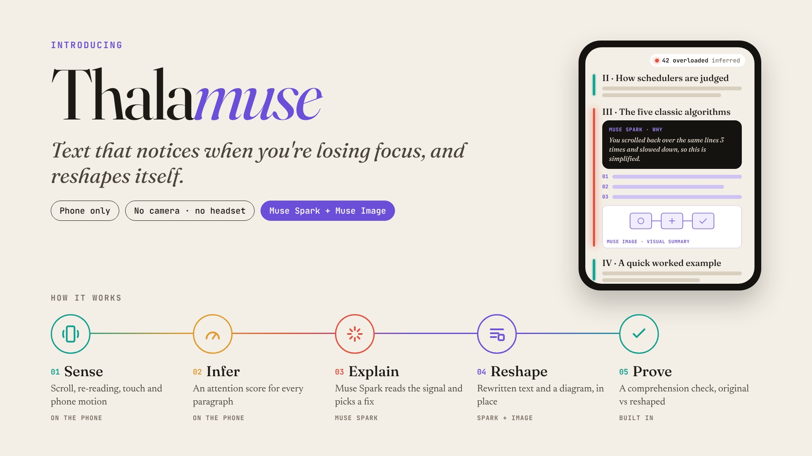
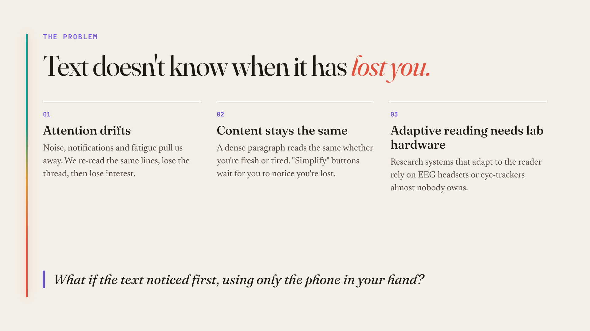
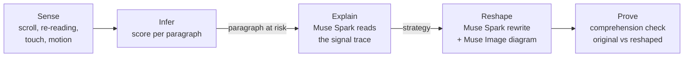
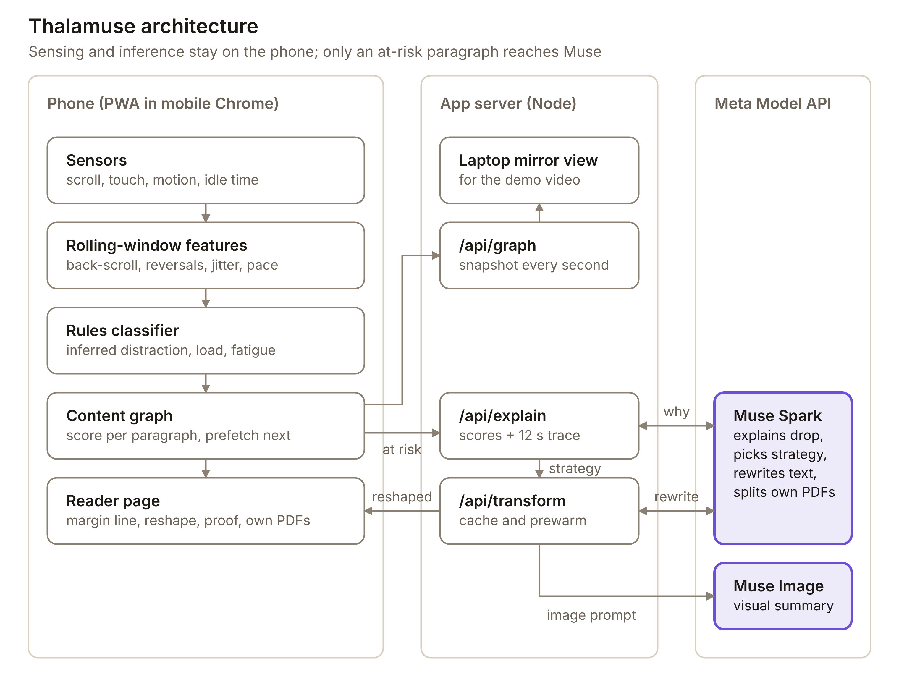
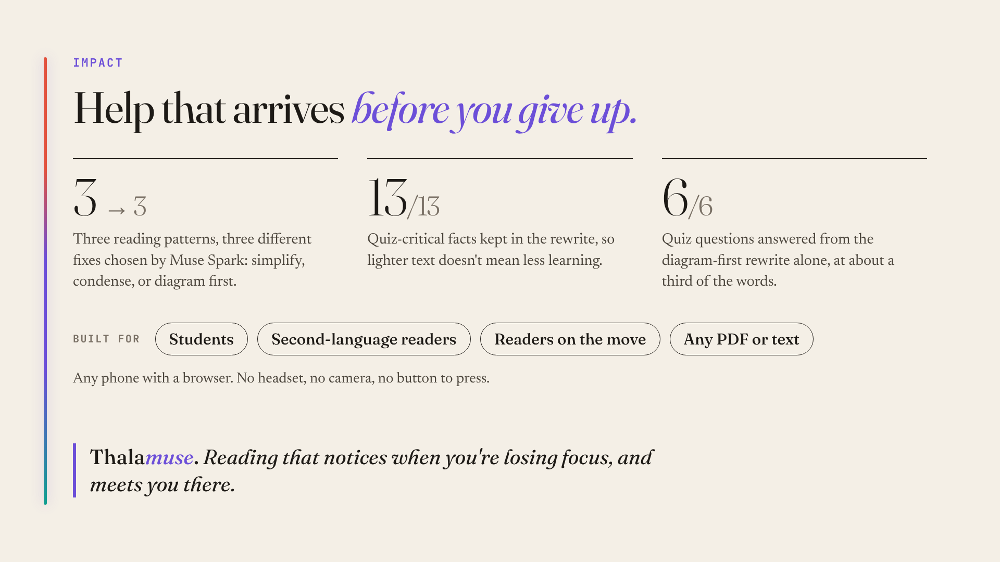

# Thalamuse

**Text that notices when you're losing focus, and reshapes itself.**

Thalamuse is an attention-aware reader that runs on the phone you already have. It infers, paragraph by paragraph, when your attention is slipping, from how you scroll, re-read, touch and hold the phone. When a paragraph is losing you, **Muse Spark** reads those signals, explains in plain words what changed and rewrites the paragraph, and **Muse Image** draws a visual summary. No camera, no microphone, no headset, and no button to press.

Built for the Meta Global AI Developer Hackathon (Indie Developer track, theme: Push the Frontier).



## Contents

- [The problem](#the-problem)
- [The solution](#the-solution)
- [How it works](#how-it-works)
- [Architecture](#architecture)
- [How Thalamuse uses Meta's Muse models](#how-thalamuse-uses-metas-muse-models)
- [Impact](#impact)
- [What makes it different](#what-makes-it-different)
- [Run it](#run-it)
- [Test it](#test-it)
- [Project structure](#project-structure)
- [Honesty and privacy](#honesty-and-privacy)
- [Roadmap](#roadmap)

## The problem



Staying focused on one topic is hard. There is noise all around us, attention drifts in and out, and somewhere along the way we lose the thread, then lose interest. But text stays the same: a dense paragraph reads the same whether you are fresh at a desk or tired on a bus.

The pieces of a fix exist, but apart:

- **Systems that adapt content to a reader's state** depend on EEG headsets or eye-trackers that almost nobody carries.
- **Phone-only attention sensing** stops at detecting a state. It never changes the content.
- **"Simplify" buttons** put the burden on the reader, who has to notice they are lost and remember to press it.

Nobody has closed the loop: ordinary phone sensors driving a generative, multimodal rewrite of the passage itself.

## The solution

Thalamuse closes that loop on a phone, in the browser:

1. **Sense.** Scroll speed and direction changes, slow back-scrolls (re-reading), touch contact, phone motion and idle time, measured on the phone.
2. **Infer.** A rules-based classifier turns those signals into inferred distraction, load and fatigue scores, and a content graph keeps a separate score for every paragraph.
3. **Explain.** When a paragraph stays at risk, Muse Spark reads the last ~12 seconds of signals and says, in one or two sentences, what changed. It then picks a strategy: simplify, condense, or diagram first.
4. **Reshape.** Muse Spark rewrites the paragraph in that strategy and Muse Image draws a visual summary. The paragraph re-forms in place, marked "Reshaped by Muse".
5. **Prove.** A built-in comprehension check has the reader read the dense section once as written and once reshaped, with a different set of questions after each, and puts the scores side by side.

It works on the built-in study chapter (CPU scheduling) or on **any PDF or text you bring**.

## How it works



What the reader sees is a book-like page:

- **A margin line beside every section** shows that section's inferred attention. It stays teal while reading goes well and warms through amber to coral as risk rises.
- **The reshape happens in three beats**, so it reads clearly on camera and in person. First the line flares and the phone gives a short vibration. Then a card shows the signal trace and Muse Spark's explanation types in. Finally the paragraph re-sets as the reshaped version and the diagram unfolds.
- **A pull-down signals panel** (tap the chip in the header) shows the inferred scores, a stylized diagram with its required caption, the content graph, the live signal trace and the raw sensor readings, with every threshold editable live.
- **An attention replay** at the end of the chapter shows one strip per section, one mark per second, coloured by the inferred state, with the point where Muse reshaped it.
- **A laptop mirror view** (`/mirror`) shows the same live state on a big screen, for demos and recording.

### Live Muse timing, and why the reader never waits

Measured against the live Meta Model API on 2026-11-04: Spark explanations took 12–18 s, paragraph rewrites 26–40 s and images 8–22 s. So Thalamuse is designed never to make the reader wait:

- When reading starts, the hard section's rewrites and image are requested in the background and cached.
- When the reader enters the section before a hard one, the content graph prefetches that hard section.
- On a hard section, Spark's explanation is requested as soon as inferred risk starts climbing, before the paragraph is formally at risk.
- If Spark's explanation still isn't back 3.5 s into the reshape, the card shows a rules-based quick read of the signal, labelled as such, and Spark's own explanation replaces it when it arrives.

## Architecture



Sensing, feature extraction, classification and per-paragraph tracking all run on the phone. The server holds the API key, calls Muse, caches results and mirrors the content graph for the laptop view. There is no database.

| Layer | File | What it does |
| --- | --- | --- |
| Sensing | `public/js/sensors.js` | `devicemotion`, `deviceorientation`, scroll and touch listeners. Rolling-window features: scroll velocity, direction reversals, slow back-scroll (re-reading), motion jitter, touch-pressure variance (contact radius when the browser reports no real force), idle time |
| Classifier | `public/js/classifier.js` | Rules, not a trained model: runs instantly on the phone, needs no training data, every threshold is tunable. Scores distraction, load and fatigue; the highest above `stateThreshold` wins, otherwise "focused" |
| Thresholds | `public/js/config.js` | Every number in one object, editable live from the signals panel and saved on the phone |
| Content graph | `public/js/graph.js` | One node per section with its own smoothed scores, dwell time and history; edges are reading order. Decides when a section is at risk, asks for Spark's explanation early on hard sections, and prefetches the next hard section |
| Reshape | `public/js/transform.js` | The three-beat reshape, prefetching, and the quick-read fallback |
| Muse proxy | `server/muse.js` | The `openai` SDK pointed at the Meta Model API. Explanation, rewrite, image and section planning, with caching, timeouts and a banned-word guard on explanations |
| Your own text | `public/js/own.js`, `server/custom.js` | PDF text extraction on the phone with pdf.js, then Spark groups the text into sections and marks the hardest |
| Proof | `public/js/quiz.js` | Comprehension check with two parallel question sets, automatic counterbalancing of order and set pairing, and JSON export of every run |
| Mirror | `public/mirror.html`, `public/js/mirror.js` | Laptop view that polls the phone's latest graph snapshot (`GET /api/graph`) |
| Visualization | `public/js/viz.js` | Stylized SVG whose regions are bound to the current section's own scores. Always shown with its caption |

### API

| Endpoint | Purpose |
| --- | --- |
| `GET /api/status` | Whether Muse is connected, and which models |
| `GET /api/article`, `GET /api/quiz` | Built-in chapter and its question sets |
| `POST /api/explain` | Section scores + ~12 s of signal rows → Spark's explanation and strategy |
| `POST /api/transform/text` | Spark rewrite of a section for a strategy (cached) |
| `POST /api/transform/image` | Muse Image visual summary of a section (cached) |
| `POST /api/prewarm` | Prepare the hard section's rewrites and image in the background |
| `POST /api/article/custom` | Your own text → sections, via Spark |
| `POST /api/graph`, `GET /api/graph` | Phone posts its content-graph snapshot; the mirror reads it |

## How Thalamuse uses Meta's Muse models

Both models are called through the Meta Model API (`https://api.meta.ai/v1`) from a small Node server, using the OpenAI-compatible `openai` SDK. The API key never reaches the phone.

| Model | Job in Thalamuse | Why it needs a strong model |
| --- | --- | --- |
| **Muse Spark** (`muse-spark-1.3`) | **Explains the drop.** Reads a section's inferred scores and ~12 s of raw signal rows, says in plain words which signals changed, and chooses simplify, condense or diagram first | Turning a numeric time series of reading behaviour into a readable cause and a decision is reasoning, not templating. It is a new kind of input for a language model: behaviour, not only words |
| **Muse Spark** | **Reshapes the passage.** Rewrites the section in the chosen strategy and returns a summary, key points and an image prompt as structured JSON | It has to cut the reading load while keeping every fact a quiz would test |
| **Muse Spark** | **Organises your own text.** Groups a PDF or pasted text into sections and marks the densest one | Needs to understand the document's structure and difficulty |
| **Muse Image** (`muse-image-1.0`) | **Draws the visual summary** from the prompt Spark wrote, shown first when Spark picks the diagram-first strategy | Moves the help beyond wording into a different form |

### Measured in a live test (2026-11-04)

`npm run live-test` sends three synthetic reading patterns through the app's own endpoints and checks the results:

- **Different readers, different fixes.** Spark chose *simplify* for the re-reader, *condense* for the skimmer and *diagram first* for the reader who stalled, and each explanation cited real numbers from its trace (for example: "Your inferred load rose from 0.2 to 0.8 as rereading grew from 40px to 600px and reversals rose from 1 to 5").
- **Lighter text, same facts.** The simplify rewrite kept all 13 facts the quiz depends on. A strict reader (Spark told to answer only from the passage) answered all 6 quiz questions from the diagram-first rewrite alone, at about a third of the original's words.
- **Your own text.** Spark split a 3-page PDF into sections with headings and correctly marked the densest section as the hard one.

## Impact



- **Who it helps:** students studying dense material on their phones (the demo chapter is exam prep), second-language readers, people reading on the move, and anyone who finds long text hard to sustain. It is reading support, never a diagnosis or a medical tool.
- **Reach:** any phone with a modern browser. No headset, no camera, no install.
- **Evidence, not adjectives:** the comprehension check is built in, alternates order and question sets automatically across readers, and exports every run as JSON, so a pilot with real readers produces a number with an n.

## What makes it different

- **No button.** The reader never asks for help. The phone notices and acts.
- **Hardware everyone already owns.** Prior adaptive-reading systems need EEG headsets or eye-trackers. This needs a phone and a browser tab.
- **A language model reading behaviour, not only words.** Muse Spark is handed a time series of scroll and motion features and asked *why* the reader struggled.
- **Per-paragraph memory and look-ahead.** The content graph knows which paragraph lost you and prepares the next hard one before you get there.
- **It measures itself.** The comprehension check turns "it helps" into a score.
- **Honest by design.** Every score says "inferred", and the diagram says it is not a measurement of brain activity.

## Run it

Requirements: Node 18 or newer, a Meta Model API key, and Chrome on an Android phone.

```bash
git clone https://github.com/Fazil-24/Thalamuse.git
cd Thalamuse
npm install
cp .env.example .env
```

Edit `.env`:

```
META_API_KEY=your-key
META_BASE_URL=https://api.meta.ai/v1
MUSE_SPARK_MODEL=muse-spark-1.3
MUSE_IMAGE_MODEL=muse-image-1.0
PORT=3000
```

Use the model ids exactly as above, without a `meta/` prefix (that returns `404 model_not_found`).

```bash
npm start                 # http://localhost:3000
```

The cover shows a green **Muse connected** pill when the key works. Without a key the server falls back to clearly labelled simulated responses, so the interface can still be explored offline; those runs are excluded from the proof averages.

### On the phone

Browsers only expose motion sensors on HTTPS, so open the app through a tunnel:

```bash
npm run tunnel            # Cloudflare quick tunnel, no account needed
# or: npm run tunnel:ngrok
```

Open the printed `https://…` link in Chrome on the phone and tap **Begin reading**. Wait about a minute on the first section before demoing, so the hard section's rewrites are cached.

To see the reshape: read sections I and II normally, then in section III ("The five classic algorithms") slow down and scroll back over the same paragraph two or three times. The margin line turns coral, the phone vibrates, Spark explains, and the section is reshaped.

### On a laptop, for demos

Open `http://localhost:3000/mirror` next to the phone. It shows the phone's live state: margin lines, inferred attention, content graph, signal trace and Spark's explanation card.

### Your own PDF or text

On the cover, tap **Or read your own PDF or text**. Pick a PDF or text file, or paste text (at least ~120 words; the first ~3000 are kept). The PDF is read on the phone, so the file itself is never uploaded; running headers, footers and page numbers are dropped and bigger-font lines become section headings. Spark then groups the text into sections. Scanned PDFs have no text layer and cannot be read. A sample PDF is in [`docs/sample-vaccines.pdf`](docs/sample-vaccines.pdf).

## Test it

| Command | What it checks | Muse calls |
| --- | --- | --- |
| `npm run check-muse` | Key, base URL and model ids: lists the models your key can see, makes one raw Spark call and one image call, and prints the exact error if anything is wrong | 2 |
| `npm run live-test` | End-to-end through the running app: three synthetic readers through `/api/explain`, all three rewrite strategies, the 13-fact retention check, Spark as a strict quiz-taker on each rewrite, the prefetch cache, and Muse Image. Writes an HTML report to `reports/` | about 11 (stops at `--budget`, default 14; `--no-image` skips the image) |
| On the phone | Tap the signal chip → *Raw sensor readings & thresholds*: "Secure context" should say yes and "Motion events" should climb when you move the phone | 0 |

Troubleshooting:

- **Motion events stay at 0:** you are not on HTTPS, or Chrome blocked motion sensors for the site (Site settings → Motion sensors).
- **The reshape never fires:** watch the signals panel while reading normally, skimming and re-reading section III, and adjust the ranges in the thresholds editor until the states separate. "Debug: force at-risk here" in the same panel triggers it manually for testing.
- **Muse errors:** the server terminal prints one `[api]` line per request and a `[muse]` line for every failure. Run `npm run check-muse`.

## Project structure

```
server/
  index.js        Express app and API routes
  muse.js         Meta Model API calls: explain, rewrite, image, section planning
  custom.js       Your own text: cleaning, blocks, sections
  demo.js         Labelled offline fallback responses (no key)
  check-muse.js   Configuration check
  live-test.js    Live end-to-end test with call budget and HTML report
public/
  index.html      Reader app (PWA)
  mirror.html     Laptop mirror view
  css/app.css     "Ink & Signal" design
  js/             sensors, classifier, config, graph, transform, viz, quiz, own, app, mirror
data/
  article.json    Built-in chapter: CPU process scheduling, five sections
  quiz.json       Two parallel 3-question sets on the dense section
docs/             Diagrams, slides and a sample PDF
```

## Honesty and privacy

Thalamuse infers an attention state from behaviour. It does not measure the brain, and it says so.

- Every score on screen is labelled **inferred**.
- The stylized diagram is bound to the same score the content graph uses and always carries the caption *"Illustrative visualization of inferred attention state — not a measurement of brain activity."*
- Spark explanations that drift into claims about the brain or the mind are discarded automatically and replaced with a rules-based one.
- Raw sensor events never leave the phone. When a section is at risk, only that section's text, its scores and ~12 s of derived signal rows go to the app's own server, which calls Muse. The API key stays on the server.
- PDFs are read on the phone; only the extracted text is sent.
- Nothing is stored server-side beyond an in-memory cache. Comprehension-check runs stay on the phone until you export them.

## Roadmap

- **Questions for any text.** Have Spark write the two parallel question sets for an uploaded PDF, so the comprehension check works beyond the built-in chapter.
- **Personal calibration.** Thresholds that learn from one reader's own baseline, still on the phone.
- **Faster reshapes.** Stream Spark's explanation as it is written, and shorten prompts for the explanation step.
- **Inside the apps people already read in.** The same loop as a reading mode for e-readers, course platforms and long chat threads, and a share target so any article can be sent to Thalamuse.
- **Pilot study.** 8–12 readers with automatic counterbalancing, reporting the mean change, the n and the spread, including readers it did not help.
- **Offline.** An on-device or open-weight model for the rewrite, so no text leaves the phone.
- **Accessibility.** Voice read-aloud of the reshaped version, and larger-type layouts.
